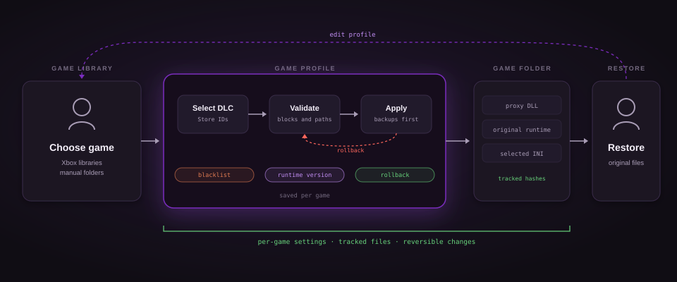

# XStore Manager

A Windows desktop manager for Microsoft Store and Xbox PC game profiles, with a maintained XStoreUnlocker runtime.



## Start

Extract the portable package and launch `XStoreManager.exe`. The full package includes the .NET runtime.

| Action | Result |
|---|---|
| Scan libraries | Finds accessible Xbox game manifests without changing game files |
| Add game | Adds a game folder manually |
| Refresh catalogue | Fetches named durable add-ons from Microsoft Store |
| Use / Block | Selects individual DLC or denies them explicitly |
| Enable runtime unlocker | Enables the profile when it is applied |
| Install / Apply | Installs the bundled engine and writes this game's settings |
| Uninstall / Restore | Restores the original files and keeps the saved profile |

New games and newly discovered DLC are disabled by default. Profile edits are saved separately; use **Install / Apply** to deploy them.

## Profiles and exclusions

| Setting | Behavior |
|---|---|
| Use | Selects this DLC when Unlock all is off |
| Block | Takes priority over Use and Unlock all |
| Mount path | Uses an existing content folder for separately installed DLC |
| Unlock all | Applies to supported durable products queried at runtime |
| Enable logging | Writes `xstore_unlocker.log` beside the game's proxy |
| Exclude from installation | Prevents future installation for this game |

For an already installed game, exclusion does not remove its files. Use **Uninstall / Restore**, or clear **Enable runtime unlocker** and apply to disable runtime changes.

The manager does not download DLC files. DLC with no custom mount path uses the game's embedded content where the runtime supports it. A selected checkbox does not prove the content is installed or playable.

## Existing installations

| Detected state | Next action |
|---|---|
| Unmodified Microsoft runtime | Install normally |
| Existing INI only | Import it, then explicitly adopt it during installation |
| Unknown proxy or backup DLL | Restore the existing installation before installing this manager |
| Managed files changed externally | Review the conflict before replacing files |
| Missing managed proxy or INI | Repair reinstalls missing files while preserving the original runtime |
| Interrupted transaction | Repair or uninstall recovers the recorded transaction first |

Original files are retained in `.xstore-manager.json`. The durable transaction journal is `.xstore-manager.transaction.json`. Keep these files until uninstall completes.

Game processes must be closed before installation or removal. The manager never changes the system runtime or takes ownership of protected folders.

## Runtime changes

| Area | Maintained behavior |
|---|---|
| Configuration | Honors disabled INI entries and normalizes Store IDs |
| Selection | Shares a deny-first policy across ID-aware hooks |
| Async operations | Retains item identity across initiation and result |
| Mount paths | Resolves package identity to Store ID before applying an override |
| Unrelated operations | Preserves original results when the item cannot be identified |
| Base-game licensing | Leaves global base-game and opaque COM operations unchanged |
| Runtime interface | Requires the SDK-confirmed Store 6 or Package 9 contract before patching |

Interface identities and method positions were verified against Microsoft's GDK 2604.5.7903 wrapper library. See [ABI provenance](tests/native/abi-provenance.txt). Older package enumeration layouts remain untouched.

Missing content, unsupported runtime interfaces, and server-controlled entitlements remain compatibility limits. Synthetic packages cannot safely bypass an error returned before a real async operation is queued.

## Data and build

Profiles are stored in `%LOCALAPPDATA%\XStoreManager`. Use `--data-dir <folder>` for an isolated profile store.

| Requirement | Version |
|---|---|
| Desktop | Windows x64 |
| Source build | .NET 8 SDK |
| Native build | Visual Studio 2022 or 2026 with Desktop development with C++ and CMake |

```powershell
./scripts/build.ps1
```

The build runs native and managed tests, then publishes the portable package to `dist/XStoreManager`. `-FrameworkDependent` produces a smaller package requiring the .NET 8 Desktop Runtime.

```powershell
./dist/XStoreManager/XStoreManager.exe --smoke-test --data-dir ./build/ui-smoke --screenshot ./build/ui.png
```

The UI smoke mode uses synthetic profiles, checks bindings and actions, and never installs into a game. Native tests and installer fixtures do not establish compatibility with every game.

## Sources and license

Based on [Zephkek/XStoreUnlocker](https://github.com/Zephkek/XStoreUnlocker), under the included GPL-3.0 license. Mount-path and selection work was informed by the [affu1212 fork](https://github.com/affu1212/XStoreUnlocker); the fork's generated binaries are not used.

Catalogue metadata comes from Microsoft's public Store endpoints. No Xbox login is requested. This program does not grant account entitlements or fulfill server-managed purchases.
